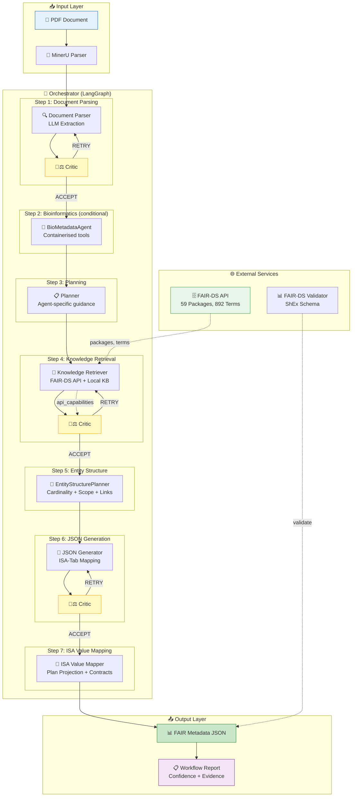

# FAIRiAgent System Architecture & Workflow

This document illustrates the detailed architecture, agent configurations, interaction flows, and developer setups for **FAIRiAgent**.

---

## 1. System Architecture Diagram

The system uses a **LangGraph-based multi-agent workflow** with API-aware evaluation and intelligent self-correction:



---

## 2. Agent & Node Breakdown

1. **Document Parser**: Extracts structured information from documents using LLM.
   - PDF ingestion retains native first-page text omitted by MinerU, with page and bounding-box references. Original conversion files remain unchanged; retrieval and value checks use the supplemented working text.
   - Routed to **Critic evaluation** → ACCEPT / RETRY (up to 2×)
2. **BioMetadataAgent** *(conditional)*: Recovers metadata from raw bioinformatics files (BAM, VCF, FASTQ) using Dockerised biocontainers (Samtools, Bcftools) from `quay.io/biocontainers`.
3. **Planner**: Analyzes document domain and generates per-agent guidance instructions.
4. **Knowledge Retriever**: Queries FAIR-DS API (59 packages, 892 terms) + local knowledge base.
   - Reports **API capabilities** for Critic awareness.
   - Routed to **Critic evaluation** → ACCEPT / RETRY / ESCALATE.
5. **EntityStructurePlanner**: Builds and independently audits the five-level
   entity graph, including factor cardinality, ISA scope, and unique parent
   linkage. Explicit source metadata tables can supply authoritative record
   identities through an agent-selected, deterministically validated table
   plan, avoiding false Cartesian expansion of incomplete designs. It owns row
   structure; downstream agents may not merge or invent entities.
   Initial planning and scope review read the same complete working text;
   later sections must be available before the entity graph is fixed.
6. **JSON Generator**: Maps extracted info to selected FAIR-DS field contracts.
   - **Recursive Batch Splitting**: Auto-detects truncation and splits batches (16→8→4→2→1 fields) to prevent token window overflow.
   - Routed to **Critic evaluation** → ACCEPT / RETRY.
   - **Cross-layer rollback** (ρ mechanism): JSON hard-gate failure triggers KnowledgeRetriever redo.
7. **ISA Value Mapper**: Projects source-backed values onto the locked entity
   graph, enforces field/value contracts and evidence scope, and compiles the
   canonical JSON/Excel matrix. Large planned matrices use batches of at most
   16 entities, 12 columns, and 16,000 estimated output characters. Each batch
   receives complete target identities, ancestors, field definitions, and a
   separate source-evidence budget. Missing rows, conflicting identities, and
   truncated responses require review; successful batches remain intact.
   Batching preserves the planned entity counts and repeated contact rows.
   Partially filled columns are reviewed in batches of at most 8 columns and
   64 cells. Original source passages are balanced across fields before
   generated hints consume the context budget. Truncated review responses
   cannot overwrite cells; a service failure stops further review calls while
   retaining completed decisions.
   Nonliteral vocabulary labels and summaries also receive record-level review,
   including fully populated columns. Empty selected columns with extracted
   candidates receive the same review, including candidates quoted verbatim.
   Accepted values remain bound to their exact cells through literal checks;
   declared value contracts still apply. Selected schema columns remain in
   JSON and Excel even when no value is available. Rejected optional values
   become blank cells; retaining a column does not count as extracting its
   values. The review ledger remains outside ISA rows.
   Quote authentication joins wrapped lowercase prose fragments and decodes
   numeric micro-unit prefixes, degree notation and labelled subscripts rendered
   by MinerU. Unit case, magnitudes, signs, subscript labels and inline hyphens
   remain significant.
   A numeric value absent from the candidates must match a complete quantity
   in the authenticated quote for that record. Signs, bounds, exponents, and
   reported uncertainty cannot be removed to obtain a match.
   Consistency checks compare records within their planned source group.
   A cited attribute with an unknown group keeps the global check; conflicting
   values for one cell remain invalid regardless of group.
8. **Critic Agent**: Embedded after most nodes; rubric-driven LLM-as-Judge.
   Matrix review receives every output column and the selected package field
   contracts. Shared non-identity metadata does not establish duplicate entities;
   field placement and value constraints remain fixed. Failed plan or matrix
   validation still requires resolution.

A workflow completion status or an LLM critic score is not, by itself, a
deliverable-quality verdict.

Prompt-based structured output includes the complete JSON Schema, including
nested item types and constraints. DeepSeek JSON output preserves the configured
thinking mode and output budget; a format fallback removes only the JSON-format
parameter. The DeepSeek adapter sends the provider's `max_tokens` parameter.
For thinking models, entity planning requests 65,536 output tokens and its
reviews request 32,768, including reasoning; non-thinking requests remain
32,768 and 8,192. Provider adapters determine the effective request limit.
Independent reported-record review retains each rejection rationale. A later
planning attempt repairs only the objects named by the current errors and
merges them back by their existing ids. Empty lists in that repair mean no
change, not deletion. Unnamed objects in the standing plan stay as they are.
Resolved errors from older candidates cannot displace the current feedback.
Different source labels can identify the same material only after independent
review verifies that association. The alias handoff is bound to the exact
proposal, material parent and source; it cannot override a conflicting material
identity or select an arbitrary physical replicate.
After material proposals pass structural and source checks, independently
reviewed results are materialized separately. A rejected result cannot discard
another accepted result. Rejected parents cannot retain their descendants,
and unresolved records still fail whole-plan validation. Among invalid drafts,
current source-bound result reviews take precedence over fewer error messages.
The JSON reader can escape a literal backslash when the decoder identifies an
invalid string escape. It preserves source text and logs the correction; it
does not complete truncated objects or supply missing values.

Reported-result proposals use a separate Assay contract for aggregate, fitted,
and qualitative results. Source-described preparations and material identities
can supply ObservationUnit and Sample records without inventing vessels,
aliquots or replicate counts. Each result references a declared Sample and
carries a source quote. Independent review checks material roles, parent links,
including ambiguity among material identities rather than their physical
replicates, as well as
result grain and field meaning; deterministic checks enforce identity, literal
values and field contracts. A reviewed analysis record does not add a physical
replicate. Its exported description identifies the result type and any reported
uncertainty about the underlying design. Review receipts bind the source,
record and parent; changes require re-review. These receipts stay in the entity
plan, outside the metadata sheet rows.

---

## 3. Self-Correction & Retry Loop Logic

- **Retry Attempts**: Up to 2 retries per agent (configurable via `max_step_retries`).
- **Global Limit**: Maximum total retries across all agents (configurable via `max_global_retries`).
- **No-Progress Exit**: If the score is unchanged for 2 consecutive attempts, the workflow accepts the output with a review flag to prevent infinite loops.
- **Cross-Layer Rollback (ρ)**: A validation failure in JSON generation routes feedback back to the Knowledge Retriever rather than just retrying JSON mapping.
- **Feedback Deduplication**: Limits guidelines to 10 items per agent to prevent token accumulation.

### Fixed contract, planned cells

The node order is fixed; the model does not add, reorder or drop nodes. Code
owns four parts of the contract (`fairifier/utils/workflow_contract.py`):

- **Skip conditions.** Only `BioMetadataAgent` may be skipped, and only for the
  enumerated `no_bio_files` condition, computed from run state. A Planner
  `skip_if` outside the enumeration is dropped at parse time.
- **Completion contracts.** Each node's output is checked deterministically
  (selected packages exist in FAIR-DS, the entity plan gate passed, confirmed
  values carry evidence, and so on). The result is recorded; it does not change
  retries, routing or `needs_human_review`. An entity plan that is still invalid
  after its bounded retries is kept, marked for review, and still used to write
  metadata and the workbook. The inner ReAct budget
  (`REACT_LOOP_MAX_ITERATIONS`, `REACT_LOOP_MAX_TOOL_CALLS`) is unchanged.
- **Node trace.** `reports/workflow_trace.json` records, per node, executed or
  skipped, attempts, last score, contract result and inner-loop budget use.
- **Fill tasks.** After the entity plan is available, one cell per
  planned entity and selected field of its level is compiled into
  `reports/fill_tasks.json`. At finalization each cell is marked from the final
  ISA matrix as `filled`, `blank` (row exists, column empty) or `row_missing`;
  the summary carries `fill_rate` and per-level counts. The generation pass
  emits fields under its own group labels and rows are expanded onto planned
  entities later, so the summary also records `first_pass.multirow_entity_alignment`
  (share of first-pass multi-row fields whose `entity_id` equals a planned
  entity) as a diagnostic of that granularity. It is not a fill status.

Fill rate is a coverage measure that needs no ground truth. It does not say
whether a filled value is correct; value accuracy still comes from the
evaluation harness.

---

## 4. State Persistence & Checkpointers

FAIRiAgent uses a checkpointer backend to persist state, enabling workflow resume.
- `none`: Stateless.
- `memory`: In-memory (dev/testing only).
- `sqlite`: Persistent SQLite database (production-ready, defaults to `output/.checkpoints.db`).

### Resource Management Snippet

```python
# Recommended for scripts using context manager
from fairifier.graph import FAIRifierLangGraphApp

with FAIRifierLangGraphApp() as workflow:
    result = await workflow.run(document_path, project_id)
    # Auto-cleanup of database connections on exit
```

---

## 5. Local Provisional Extensions

Add custom terms to local knowledge base at `kb/`:

```python
from fairifier.services.local_knowledge import initialize_local_kb, LocalTerm
from pathlib import Path

local_kb = initialize_local_kb(Path("kb"))
local_kb.add_term(LocalTerm(
    name="custom_field",
    label="Custom Field",
    description="Project-specific metadata field",
    source="local",
    status="provisional",
    confidence=0.7
))
```

---

## 6. Output Files & Formats

Outputs are saved under `output/<project_id>/` and grouped by purpose:

- `deliverables/`: `metadata.json`, `isa_values.json`, and
  `metadata_fairds.xlsx`.
- `logs/`: `full_output.log`, `processing_log.jsonl`, `llm_responses.json`, and
  other execution traces.
- `reports/`: runtime configuration, validation, workflow, and auto-repair
  reports.
- `workspace/`: preserved source material and intermediate working data.

The run directory is not created until the workflow performs its first write.
Each functional subdirectory is also created lazily on its first artifact write;
an absent directory therefore means that the run produced no artifact of that
class. API request validation and project registration must complete before any
run directory is materialized. This prevents rejected or never-started requests
from leaving empty `fairifier_<timestamp>` directories.

Key artifacts include:

1. **`deliverables/metadata.json`**: Standardized FAIR-DS JSON (includes `isa_values` and
   `isa_matrix_id` when the ISA matrix compiler ran).
2. **`deliverables/isa_values.json`**: Compiled ISA columns×rows sidecar; kept in sync
   with `metadata.json.isa_values` after ISAValueMapper / AutoRepair.
3. **`logs/processing_log.jsonl`**: Real-time structured log events (including critic
   evaluations when available).
4. **`logs/llm_responses.json`**: Complete record of all LLM requests/responses.
5. **`reports/runtime_config.json`**: Environment and config variables used in the run.
6. **`reports/auto_repair_trace.json`**: Deterministic repair decisions when auto mode
   applies patches.
7. **`reports/workflow_report.json` / `reports/workflow_report.txt`**: Quality, retrieval,
   execution, and performance telemetry. The `performance` block records
   workflow wall time, per-phase agent/LLM latency, observed input/output
   tokens, configurable USD estimates, and report-only latency/token/cost
   gates. Usage or pricing that a provider does not expose is marked
   `insufficient_data` rather than estimated as zero.
8. **`reports/validation_report.txt`**: ShEx/validator report (optional).

Preserved source files live under `workspace/source_workspace/`, not at the run root.

Cost estimates use the run-specific rates configured through
`FAIRIFIER_LLM_INPUT_COST_PER_MILLION_USD`,
`FAIRIFIER_LLM_OUTPUT_COST_PER_MILLION_USD`, and optionally
`FAIRIFIER_COMPUTE_COST_PER_HOUR_USD`. A value of `-1` means unknown; use `0`
only when the endpoint is intentionally free/local. Gate thresholds use the
`FAIRIFIER_PERFORMANCE_MAX_*` settings documented in `env.example`. Gates are
diagnostic and do not change workflow completion status.

### Output JSON Schema Example

```json
{
  "fairifier_version": "V2.3.0",
  "generated_at": "2026-07-17T18:00:00",
  "document_source": "paper.pdf",
  "overall_confidence": 0.85,
  "metadata": [
    {
      "field_name": "project_name",
      "value": "Soil Metagenomics Study",
      "evidence": "Extracted from title",
      "confidence": 0.95,
      "origin": "document_parser",
      "package_source": "MIMAG",
      "status": "confirmed"
    }
  ]
}
```

---

## 7. Developer Tracing & LangSmith

To debug multi-agent trajectories, configure LangSmith:
```bash
export LANGCHAIN_TRACING_V2="true"
export LANGSMITH_API_KEY="your_api_key"
export LANGSMITH_PROJECT="fairifier-testing"
```
Or launch locally via LangGraph Studio:
```bash
langgraph dev
# Studio open at http://localhost:8123
```
